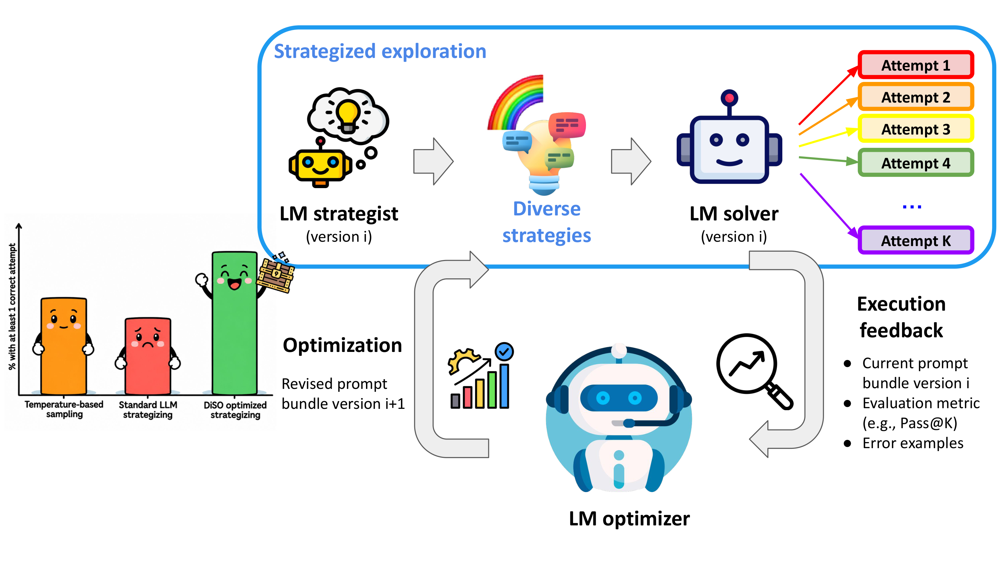
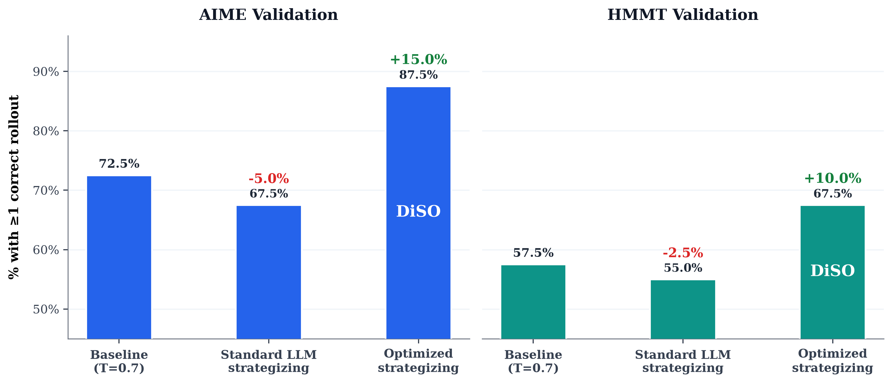
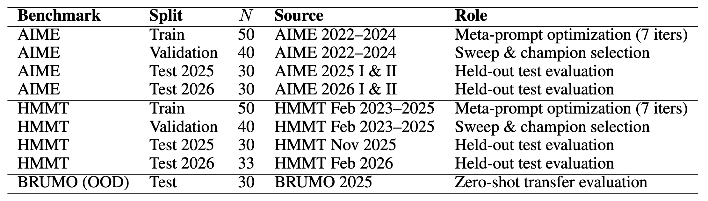
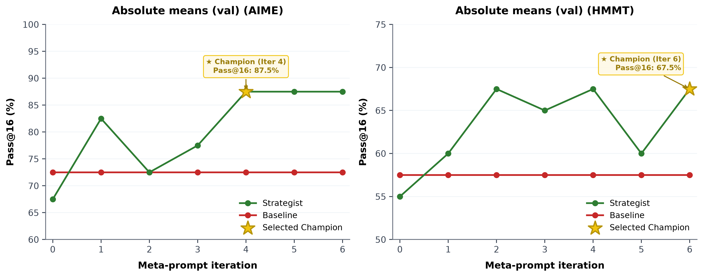
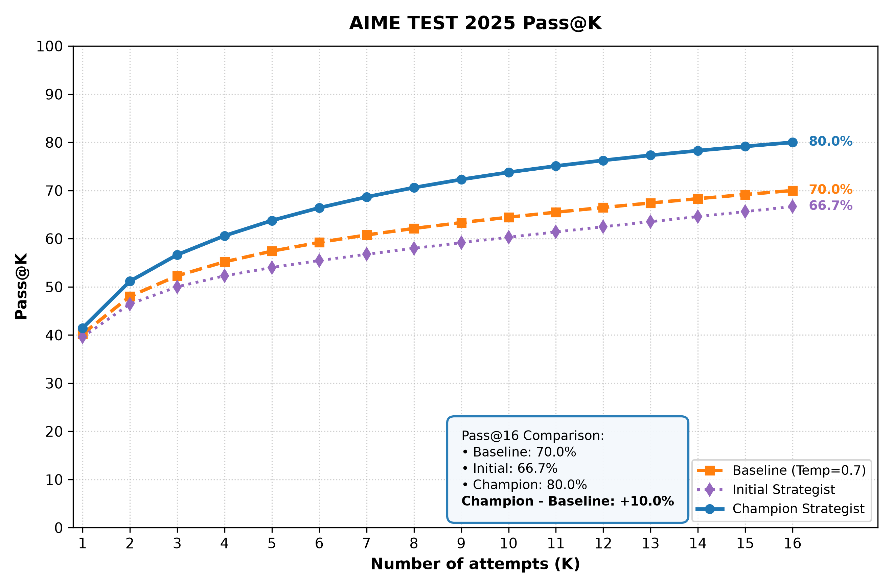
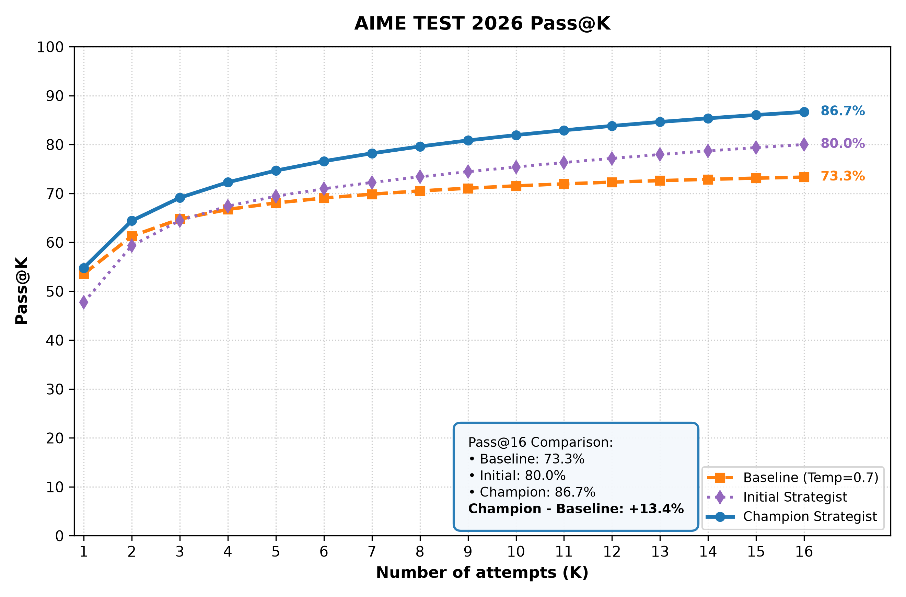
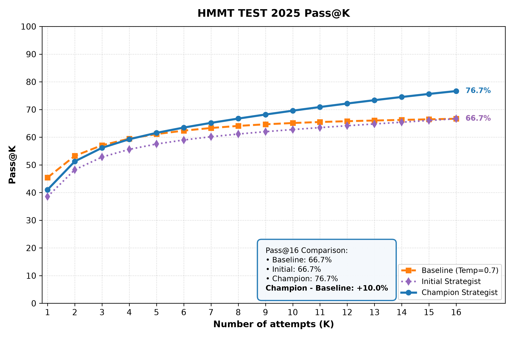
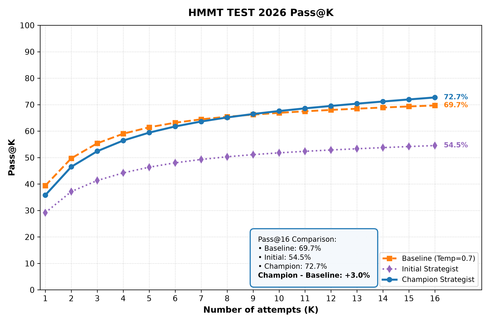
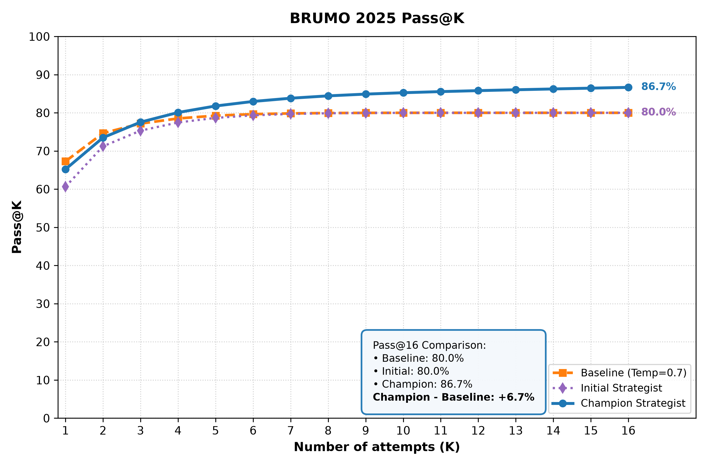
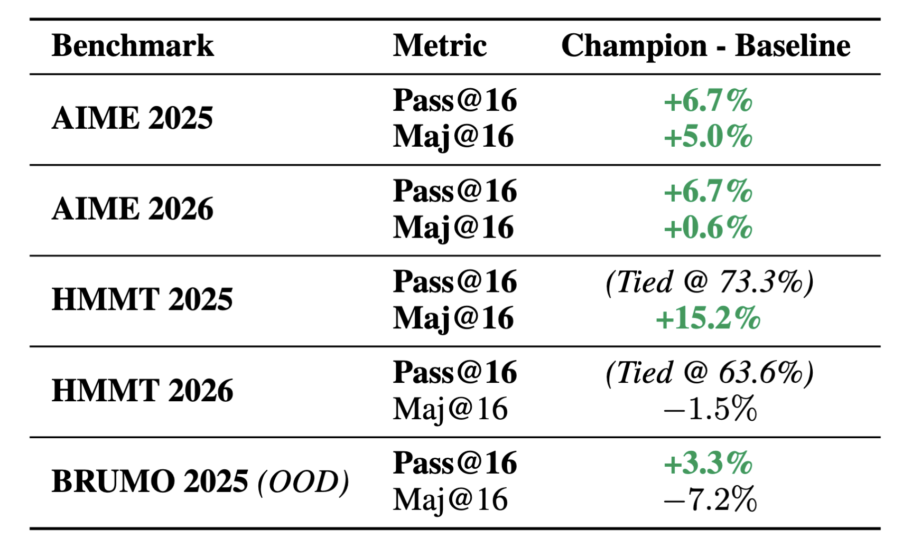

# Diversity-driven Strategic Optimization (DiSO) elicits Breakthroughs in LLMs

<!-- Other possibilities:
Strategized Strategizing: You can when you strategize! 
Diversity-driven Semantic Optimization
Diversity-driven Strategic Optimization (DiSO) for Unlocking LLMs' Potential -->

<p align="center"></p>

*Figure: **Overview of DiSO (Diversity-driven Strategic Optimization).** LLMs may not be natural explorers out of the box, but with DiSO, they can learn to explore—unlocking breakthroughs across the frontier of challenging tasks. DiSO unlocks effective exploration via a simple inference-time loop: (1) an **LM Strategist** proposes K diverse strategies for a task; (2) an **LM Solver** executes the K rollouts in parallel; and (3) an **LM Optimizer** meta-optimizes the strategized exploration prompts based on execution feedback to systematically refine how the exploration is done. Over successive iterations, DiSO discovers generalizable principles for strategized exploration that drive gains over both unstrategized sampling and standard LLM strategizing.*


## Overview


AI systems have achieved remarkable success on a range of tasks through [advances in post-training](https://arxiv.org/abs/2411.15124), but currently accuracy, format, style and helpfulness are often prioritized over output diversity. This creates a problem: sharpened probability distributions inducing homogenized generations and restricting the range of ideas in creative or exploratory domains. In this work, we present **DiSO** (**Di**versity-driven **S**trategic **O**ptimization), a simple framework that unlocks diverse trajectories at inference time to achieve breakthroughs in challenging, exploratory tasks. 

**🚀 TLDR: *LLMs are bad explorers! But we can make them learn to explore -- with DiSO! :)***


DiSO (pronounced *"dye-so"*) operates via an iterative 3-part loop:
1. **Strategized Exploration**: Writing an initial prompt that, given a task specification, prompts an LM ($\text{LM}_{\text{strategist}}$) to generate K different ways or strategies for exploring how to tackle the task.
2.  **Parallel Rollout & Evaluation**: Evaluating running those separate K rollouts (using $\text{LM}_{\text{solver}}$) on the task.
3. **Semantic Meta-Optimization**: Asking an LM ($\text{LM}_{\text{optimizer}}$) to optimize the diversity-driven strategizing prompt in Step 1 given the results from Step 2.


This procedure is iterated until the meta-optimization converges (the unoptimized vs. optimized prompt remain the same for an iteration) or a fixed number of iterations is reached. 

We evaluate our method across five challenging math competition benchmarks from [MathArena](https://matharena.ai/): AIME 2025, AIME 2026, HMMT 2025, HMMT 2026, and BRUMO 2025. Empirically, DiSO consistently outperforms standard temperature-based sampling, demonstrating higher chances of discovering a correct solution using DiSO-optimized exploration.


## Background

Post-training of large language models often prioritizes accuracy, helpfulness, and style over diversity. These methods tend to sharpen the output distribution and result in models that produce outputs clustering around a narrow set of predictable patterns--nothing in their training incentivizes exploring the alternatives.


This creates a fundamental bottleneck whenever discovering the optimal outcome requires wider exploration of the solution space. Diversity of thought is precisely what unlocks breakthrough progress in exploratory domains—such as tackling competition-level mathematical problems, uncovering novel scientific hypotheses, formal theorem proving, creative writing, and synthesizing alternative trajectories in multi-step agentic systems. When search is confined to a single sharpened probability basin, models fail to find non-obvious breakthrough solutions or easily get stuck in repetitive failure modes.


Existing efforts to restore diversity have focused either on training-based algorithms or prompting the model to generate different responses. On one side, RL-based methods that jointly optimize diversity and quality (e.g., [DivPO](https://arxiv.org/pdf/2501.18101), [DARLING](https://arxiv.org/pdf/2509.02534)) have shown significant improvement compared to DPO, GRPO. On the other side, inference-time approaches (e.g., [Verbalized Sampling](https://arxiv.org/pdf/2510.01171), [GuidedSampling](https://arxiv.org/pdf/2510.03777v1)) suggest that existing models already possess latent capabilities to explore diverse output spaces without alternative training methods. Yet, these inference-time strategies face an inherent ceiling: they are only as effective as the prompts that guide them. Static, hand-engineered or single-shot LLM-written scaffolds that only encourage rollouts to be **different** fail to adapt to complex exploration techniques required for **succeeding** at different tasks and domains, leaving a critical gap for an inference-time mechanism that **strategizes the exploration** and further **systematically optimizes the strategizing** to better unlock breakthroughs.


## The failure of Standard LLM Strategizing

Attaining breakthroughs on challenging tasks requires strategic exploration. Solving competition-level mathematics problems, such as those from the American Invitational Mathematics Examination (AIME) and the Harvard-MIT Mathematics Tournament (HMMT), requires exploring a range of techniques and specialized problem-solving tricks, all within a fixed time constraint that demands both efficient and strategic diversity-oriented exploration. They provide a rigorous testbed for us to evaluate the efficacy of diversity-optimizing approaches in uncovering the correct solution under a fixed budget. In our setting, a model is given a question from such competition, and K tries to produce at least one correct solution out of those attempts.  

To establish our starting point, we consider two ways for generating K tries:
1. **Unstrategized Temperature-based Sampling ($T=0.7$)**: Sampling K independent rollouts directly from the solver model without any strategizing.
2. **Standard LLM Strategizing**: An LLM-generated prompt asking an LM strategist to formulate K strategies to ensure a diverse range of mathematical paradigms and execution paths are explored. These strategies are then injected into K parallel solver rollouts.

We use Gemini 3.1 Flash Lite as both the strategist and solver model, and use K=16 throughout our experiments for consistency.

We find that:

**There exists much room for improvement beyond the Unstrategized Temperature-based baseline.** By sampling K independent rollouts directly from the solver model without any strategizing on how to use these tries for exploration, the model never got to the correct answer on 27.5% of the problems in AIME and 42.5% of the problems in HMMT. Crucially, when temperature-based sampling never got to the correct answer, it does not fail stochastically: in 54.5% of failed AIME problems and 52.9% of failed HMMT problems, more than half of all attempts **converged onto the exact same incorrect answer**.

**Standard LLM Strategizing does not always help.** We prompted Gemini 3.8 Flash to build a meta-prompt that, given a competition-level mathematics problem, generates K different ways or strategies for solving that problem. Using such LLM-generated prompt to formulate K diverse strategies for exploring the output space, despite its detailedness and best intentions, did not help and instead hurt the performance a little (-5.0% and -2.5% regression). Indeed, such prompt-based methods are only as good as the prompt gets.


<p align="center"></p>

*Figure: <!--Percentage of problems with at least 1 (out of 16) correct attempts across AIME and HMMT validation splits comparing unstrategized temperature-based sampling basline, standard LLM strategizing, and our DiSO-optimized strategizing.--> **Standard LLM strategizing does even worse than the unstrategized temperature-based baseline, while meta-optimizing the strategizing principles for performance maximization leads to significant gains.** On AIME and HMMT tasks, we find that Standard LLM Strategizing could lead to regressions compared to the baseline. Our approach, DiSO (Diversity-driven Strategic Optimization), instead meta-optimizes the strategizing principles on a small training set of questions, resulting in strategies that actually lead to performance gains.*


<details>
<summary><b>🔍 View Example: Standard LLM Strategizing Prompt</b></summary>

```markdown
SYSTEM_PROMPT = """You are a master mathematical strategist for solving competition math problems. By strategizing, you are capable of solving any problem.
Your role is not to compute the final answer yourself, but to analyze competition math problems and allocate a strategic portfolio across exactly {k} independent solver attempts to make sure that AT LEAST ONE attempt arrives at the correct answer (maximizing Pass@{k}). After making sure of that, of course the more correct attempts the better."""

USER_PROMPT = """You have a strict budget of exactly {k} tries to solve this competition problem. Formulate and allocate the {k} strategies to apply across each of these {k} tries to ensure at least 1 try succeeds:

Problem:
{problem}

STRATEGIZING PRINCIPLES FOR PASS@{k} MAXIMIZATION:
1. Paradigm Diversity & Orthogonality: Spread your attempts across fundamentally distinct mathematical angles. If one paradigm fails, other paradigms should still remain viable as alternative tries.
2. Selective Redundancy for Error-Prone Approaches: If a strategy is high-leverage and mathematically sound but technically difficult or calculation-heavy (prone to algebraic slip, tricky sign errors, or arithmetic mistakes), you may repeat and allocate that strategy across separate tries to ensure at least one attempt executes cleanly.
3. Actionable Procedural Directives: For each try, give a crisp, step-by-step procedural directive specifying how a solver should approach and execute the derivation.

Output all {k} allocated tries strictly within the following XML format:

<strategies>
  <strategy index="1" name="[Descriptive Name]">
    <directive>[Actionable procedural directive explaining the distinct angle/heuristic for Try 1]</directive>
  </strategy>
  ...
  <strategy index="{k}" name="[Descriptive Name]">
    <directive>[Actionable procedural directive explaining the distinct angle/heuristic for Try {k}]</directive>
  </strategy>
</strategies>
"""
```
</details>


## Diversity-driven Strategic Optimization (DiSO)
The previous section showed that diversifying model outputs through temperature-based sampling or standard LLM strategizing to explore the output space both leave significant performance on the table. We then ask the question: *can this be fixed by learning how to explore?*

Our approach to learning how to explore, called **Diversity-driven Strategic Optimization (DiSO)**, is simple:
1. **Strategized Exploration ($\text{LM}_{\text{strategist}}$)**: Write an initial meta-prompt that, given a problem, allocates a portfolio of K attempts to explore diverse execution paths, applying strategizing principles aimed at performance maximization. 
2. **Parallel Rollout & Evaluation ($\text{LM}_{\text{solver}}$)**: A solver model independently executes these K different rollouts in parallel. Evaluating the rollouts yields rich execution feedback: revealing which strategizing principles succeeded or failed.
3. **Semantic Meta-Optimization ($\text{LM}_{\text{optimizer}}$)**: An optimizer model inspects this execution telemetry (from Step 2) and optimizes the Step 1 meta-prompt's strategizing principles on how to allocate the K tries to explore the solution space.

This **meta-prompt optimization procedure** is iterated on a small set of training problems until the strategizing meta-prompt converges or up to a fixed number of iterations. DiSO operates entirely in natural language prompt space at inference time, and arrives at an optimized set of strategizing principles for exploring the solution space under a finite computational budget.


## Can learning how to explore lead to breakthroughs?
Our goal, in the context of competition-level mathematics tasks, is to allocate a finite budget of K tries across mathematical paradigms and execution paths to ensure a diverse range of strategies are explored, and that **at least one** attempt arrives at the exact correct answer (i.e. maximizing Pass@K). Using DiSO, we begin with an initial meta-prompt: given a competition mathematics problem, it prompts an LLM to formulate K strategies for solving the problem (using the Standard LLM Strategizing prompt described [earlier](#the-failure-of-standard-llm-strategizing)). We score the quality of this meta-prompt using the Pass@K accuracy (the percentage of problems where at least one rollout succeeds) on a small training set of 50 problems.

Our optimization procedure then iterates a simple refinement loop over a fixed number of iterations. At each iteration, we present an optimizer LLM with the current meta-prompt bundle (consisting of the system and user prompts for both the strategist and solver), the Pass@K accuracy achieved under the current exploration strategizing, and specific failure cases where none of the K attempts arrived at the correct answer. We then ask it to revise the strategizing principles to directly maximize Pass@K, while enforcing a total character limit on the prompt bundle so the optimizer must consolidate and prioritize high-leverage heuristics rather than endlessly accumulating requirements. After all iterations have completed, we select a champion meta-prompt bundle based on Pass@K performance on a held-out validation set of 40 problems (breaking ties sequentially by Maj@K, Pass@1, and earlier checkpoint iteration).


### Empirical Investigation

To show the feasibility of our approach, we conduct 7 iterations of meta-prompt optimization for each of the AIME and HMMT competition-level mathematics tasks. For each benchmark, we collect a pool of 90 problems from past years (AIME 2022–2024 and HMMT Feb 2023–2025, respectively), which are randomly shuffled and partitioned into 50 for training and 40 held out for validation. Gemini 3.1 Pro Preview is used as the meta-optimizer and Gemini 3.1 Flash Lite as both the strategist and solver model. We use a fixed K=16 rollouts throughout.

<p align="center"></p>

*Table: Overview of dataset splits and sources across different stages. Past year problems are partitioned into training (N=50) and validation (N=40) sets. Held-out 2025 and 2026 competitions as well as the BRUMO 2025 set serve as evaluation benchmarks.*


After the iterations are completed, we evaluate Pass@16 on the held-out validation set (N=40) at each checkpoint to assess whether meta-prompt refinement generalizes beyond the training batch. We find that, across both tasks, standard LLM strategization of the exploration starts out performing worse than temperature-based baseline, but over meta-optimization iterations, the optimized strategist overtakes the baseline early on and continues its optimization while always staying above the baseline from iteration 3 onwards. The learned exploration principles fix the collapse of unstrategized temperature-based sampling and the fragility of exploration guided by standard LLM strategizing, leading to Pass@K performance breakthroughs. We also observe that this meta-optimization iterative process is robust to unintentional regression e.g., on iteration 2 for AIME and iteration 3 and 5 for HMMT, the optimizer revisions of the meta-prompt led to regression in strategist performance, but the previously attained performance gains were always restored or surpassed in later iterations.


<p align="center"></p>

*Figure: Validation Pass@16 across 7 meta-prompt optimization iterations on AIME (left) and HMMT (right), comparing the evolving strategist (green) to the unstrategized temperature-based sampling baseline (red). The selected champion checkpoint on each benchmark is marked with a gold star (Iteration 4 on AIME at 87.5%, and Iteration 6 on HMMT at 67.5%). On both benchmarks, naive initial strategizing (iteration 0) underperforms the baseline, but iterative meta-optimization consistently elevates validation performance, reaching 87.5% on AIME (+15.0% over baseline) and 67.5% on HMMT (+10.0% over baseline).*


### Analysis of learned strategic exploration principles
The initial strategizing prompt, before learning how to explore, already contained principles intended to guide exploration—such as encouraging fundamentally distinct mathematical angles and allowing selective redundancy for error-prone approaches. While seemingly reasonable, we observe that these had the unfortunate effect of forcing the solver into brutal approaches that LLMs struggle with (e.g., Barycentric Coordinates, Projective Geometry, Brute-Force Python Simulation), as well as wasting attempts on duplicate failure paths (e.g., clone strategies explicitly titled "(Redundant)") rather than encouraging genuine exploration, ultimately leading to degraded performance.

Inspecting the optimized prompt suggests that DiSO learns a far more detailed and nuanced notion of exploration. Over the iterations, the optimizer systematically refines the initial strategizing principles: allocating attempts across fundamentally distinct mathematical frameworks with concrete examples of what 'distinct' entails (e.g., synthetic vs. analytic geometry), while allowing bounded redundancy with varied execution mechanics rather than mere duplicates. The learned principles also expand, for instance, to ground strategies in standard competition-math toolkits (e.g., small-case extrapolation, Burnside's Lemma) and LLM-friendly heuristics (e.g., 'elegant, low-algebra approaches' for AIME and 'avoid massive DP or Transfer Matrices' for HMMT). DiSO reshapes not only *what* the principles are, but *how* they are phrased and *where* they are placed across the prompt bundle—elevating high-level principles into the system prompt and dedicating the user prompt to an explicit pre-execution problem analysis. Because the meta-prompt is length-bounded, the optimized prompt settles into a compact, stable set of around five core principles that sharpen strategized exploration and drive performance breakthroughs on held-out benchmarks rather than endlessly accumulating prompt requirements.


<details>
<summary><b>🔍 View Example: DiSO-optimized Strategizing Prompt (for AIME)</b></summary>

```markdown
SYSTEM_PROMPT = """You are an elite mathematical strategist directing an LLM solver to solve a competition math problem via {k} independent attempts, maximizing Pass@{k}.
Your role is to architect {k} distinct, actionable execution paths.
CORE PRINCIPLES:
1. Broad Foundational Diversity: Distribute {k} tries across 4-6 fundamentally distinct mathematical frameworks (e.g., synthetic vs analytic geometry, generating functions vs casework, algebraic manipulation vs bounding, pattern recognition on small cases).
2. Bounded Redundancy: Max 2-3 tries per framework. Vary execution mechanics (e.g., different coordinate origins, complementary vs direct counting, alternative casework pivots).
3. Domain Anchors & LLM-Friendly Paths: Equip tries with standard competition toolkits (Combinatorics: PIE, small-case extrapolation, Burnside's; Geometry: Cartesian/complex, synthetic invariants; Algebra: substitutions, bounding; Number Theory: CRT, modular arithmetic). Favor elegant, low-algebra approaches since the solver is an LLM prone to arithmetic errors.
4. Actionable Roadmaps, No Micro-Algebra: Directives must be step-by-step high-level roadmaps defining parameterizations, coordinate choices, or casework structures. NEVER dictate explicit intermediate algebraic formulas or compute values.
5. Intractability Awareness: Design paths that avoid massive polynomial expansions or deep nested radicals."""

USER_PROMPT = """Problem:
{problem}

Allocate exactly {k} strategies.
First, write an <analysis> block:
- Target: Identify the exact quantity requested (e.g., if probability is m/n, target is m+n).
- Mathematical Core: Identify the underlying structure (e.g., maximal intersecting families, Burnside's Lemma, modular inverses).
- Traps: Flag deceptive assumptions, calculation-heavy traps, and intuitive attractor traps.
- Frameworks: Select 4-6 distinct high-leverage mathematical paradigms to distribute the {k} tries across.

Then, output exactly {k} strategies in this XML format:
<strategies>
  <strategy index="1" name="[Name]">
    <directive>[Step-by-step actionable roadmap specifying the framework, parameterizations, or coordinate choices. NO explicit arithmetic/formulas.]</directive>
  </strategy>
  ...
  <strategy index="{k}" name="[Name]">
    <directive>[...]</directive>
  </strategy>
</strategies>"""
```
</details>

## Main Experiments

Much like human competition participants who review and solve past-year questions to hone problem-solving intuition, strategic heuristics, and time allocation before competing in unseen contests, DiSO meta-optimizes strategic exploration prompts entirely on past competition problems (N=50 training set and N=40 validation set). We then freeze the selected champion meta-prompt bundle and evaluate its ability to guide inference-time exploration on held-out, future competitions. Of course, past problems from the same competition are not always available—such as when not released to participants or when facing a newly established competition—so we also evaluate out-of-distribution transfer.

We compare inference-time exploration from:
1. **Unstrategized Baseline**: Independent rollouts sampled directly from the solver model at temperature 0.7 without strategic guidance.
2. **Initial Strategist**: The initial LLM-generated strategizing prompt bundle prior to meta-optimization.
3. **DiSO Champion Strategist**: The prompt bundle meta-optimized by DiSO.

In competition-level mathematics, our objective is to strategically allocate a finite budget of K tries to explore distinct mathematical paradigms and execution paths. By ensuring good strategic exploration, we maximize the probability that at least one attempt arrives at the exact correct answer. We therefore evaluate exploration using Pass@K, tracking performance across rollout budgets $k = 1 \dots 16$ to assess how rapidly each method uncovers correct solutions under varying compute budgets. In particular, we focus our analysis on Pass@16 results as Pass@16 was the target of our meta-optimization and champion selection.

### AIME

**Task Overview.** The American Invitational Mathematics Examination (AIME) consists of integer-answer questions (ranging from 000 to 999) spanning number theory, algebra, combinatorics, and geometry. We use DiSO to learn strategies for exploration using the AIME 2022–2024 problems, giving us our DiSO Champion Strategist. Performance was then evaluated across two full held-out test suites: AIME 2025 and AIME 2026.

<p align="center">
  
  
</p>

*Figure: **Combinatorial Pass@K on held-out AIME evaluation.** Left: AIME 2025, where DiSO Champion reaches 80.0% Pass@16, outperforming the unstrategized baseline (70.0%, **+10.0%**) and the initial strategist (66.7%). Right: AIME 2026, where DiSO Champion achieves 86.7% Pass@16, with a **+13.4%** lead over the baseline (73.3%) and surpassing initial strategizing (80.0%).*


**Evaluation & Results.** As shown in the Pass@K trajectories on AIME 2025 and 2026, DiSO leads to performance breakthroughs unattained by unstrategized sampling (baseline) or standard LLM strategizing (initial strategist):
- On **AIME 2025**, the DiSO champion reaches **80.0% Pass@16**, representing a **+10.0% absolute improvement** over the unstrategized sampling baseline (70.0%) and a **+13.3% improvement** over the initial strategist (66.7%).
- On **AIME 2026**, DiSO scales to **86.7% Pass@16**, delivering a decisive **+13.4% margin** over the baseline (73.3%) and outperforming the initial strategist (80.0%).
- While the initial strategist (standard LLM strategizing) is unpredictable—surpassing the baseline on AIME 2026 (+6.7%) but falling behind it on AIME 2025 (−3.3%)—DiSO eliminates this fragility, consistently establishing large margins over both at Pass@16.
- For AIME, DiSO also accelerates search efficiency across early and intermediate budgets: for instance, on AIME 2025, the DiSO champion at K=8 already achieves 70.7% Pass@K, matching the terminal performance that unstrategized temperature sampling only reaches at K=16.

---

### HMMT

**Task Overview.** The Harvard-MIT Mathematics Tournament is one of the largest and most prestigious collegiate-run high school competitions.
The November tournament spans mid-AMC to upper-AIME difficulty, featuring challenging and non-standard problems from all areas of high school mathematics. The February tournament targets mid-AIME to Olympiad-level problems, requiring deeper, and more specialized mastery, spanning number theory, algebra, combinatorics, and geometry. Furthermore, unlike AIME's strict integer answer format (000–999), HMMT answers can be arbitrary mathematical expressions—including fractions, radicals, or coordinate tuples—demanding precise symbolic derivations. We use DiSO to learn strategies for exploration using past HMMT February problems from 2023 to 2025, yielding our DiSO Champion Strategist. We then evaluate performance across two held-out test suites: HMMT November 2025 and the HMMT February 2026.

<p align="center">
  
  
</p>

*Figure: **Combinatorial Pass@K on held-out HMMT evaluation.** Left: HMMT November 2025, where DiSO Champion reaches 76.7% Pass@16, outperforming both the unstrategized baseline and the initial strategist (both at 66.7%, **+10.0%**). Right: HMMT February 2026, where DiSO Champion achieves 72.7% Pass@16, maintaining a **+3.0%** lead over the baseline (69.7%) and substantially outperforming the initial strategist (54.5%, **+18.2%**).*

**Evaluation & Results.**
- On **HMMT 2025**, the DiSO champion achieves **76.7% Pass@16**, a breakthrough performance gain compared to both the unstrategized temperature-based baseline (66.7%, a **+10.0% gain**) and the initial strategist (66.7%, **+10.0% gain**). Throughout the rollout budget $K \in \{6, \dots, 16\}$, DiSO maintains an unbroken performance advantage.
- On **HMMT 2026**, DiSO achieves **72.7% Pass@16**, outperforming the unstrategized baseline (69.7%, **+3.0% gain**) and substantially reversing the severe regression of the initial strategist from the baseline (**54.5%**, DiSO enables **+18.2% recovery**).
- Just as on AIME, standard LLM strategizing proves highly fragile on HMMT, suffering a steep regression on HMMT 2026 (−15.2% below baseline). DiSO demonstrates robustness against such fragility across both benchmarks, showing how meta-optimizing exploration principles produces more task-adaptive and reliable performance gains.


### BRUMO (Out-of-Distribution Transfer)

**Task Overview.** Past problems from the same competition are not always available—such as when not released to participants or when facing a newly established competition—so we also evaluate out-of-distribution transfer. To test whether DiSO learns generalizable exploration principles that extend to a whole different competition, we evaluate the champion bundle from HMMT optimization (as described [above](#hmmt)) on the Brown University Mathematics Olympiad (**BRUMO 2025**) in a strict zero-shot, out-of-distribution (OOD) setting. Like HMMT, BRUMO answers can be arbitrary mathematical expressions. We take the prompt bundle meta-optimized *exclusively on HMMT* and deploy it directly onto BRUMO 2025 without any further tuning, prompt revision, or task-specific examples. For completeness, we also include the HMMT initial bundle for comparison.


<p align="center"></p>

*Figure: **Zero-shot out-of-distribution** Combinatorial Pass@K on BRUMO 2025 comparing the HMMT-evolved DiSO Champion prompt bundle, HMMT initial prompt bundle, and unstrategized temperature-based baseline. **OOD DiSO** achieves 86.7% Pass@16 (**+6.7%** over the baseline and initial strategist, both at 80.0%).*

**Evaluation & Results.**
- **Strong zero-shot out-of-distribution transfer**: Meta-optimized exclusively on HMMT, the DiSO champion transfers directly to BRUMO 2025 with zero tuning—achieving **86.7% Pass@16** and delivering a **+6.7% gain** over both the unstrategized baseline and the initial strategist (both at 80.0%).
- **Learning generalizable principles for strategic exploration**: Across rollout budgets from K=4 to K=16, the HMMT-evolved champion prompt consistently dominates both comparators on BRUMO in a completely zero-shot, out-of-distribution setting. Inspecting the champion bundle confirms that DiSO learns universal exploration doctrines—such as capping redundancy, varying execution pivots, and steering clear of brittle computational traps—rather than memorizing HMMT-specific patterns.
- **Promise for diverse applications**: These results demonstrate that meta-optimized exploration principles generalize robustly across distinct competition distributions and opens exciting opportunities for applying DiSO across a diverse range of applications to achieve breakthroughs in challenging, exploratory tasks.

## Ablation and other experiments
**Baseline-Aware Meta-Optimization.** Beyond optimizing the strategist for exploration purely on its own execution telemetry, we explored a *baseline-aware* variant where the optimizer also explicitly receives comparative performance signals concerning the temperature-based baseline alongside the evolving prompt bundle—that also includes Baseline Pass@16, differential margins (Strategist - Baseline  Pass@16), joint failures, and direct regression cases where temperature sampling baseline succeeded while the strategist failed. We observe that a setup that includes this additional comparative telemetry also yields somewhat consistent gains across held-out evaluation benchmarks (e.g., matching or exceeding the baseline across AIME, HMMT, and BRUMO OOD transfer). 

<p align="center"></p>


*Table: Evaluation of the Baseline-Aware variant across benchmarks at K=16. While it consistently matches or beats the baseline (see **bolded metrics**)—and yields massive consensus gains like +15.2% Maj@16 on HMMT 2025, its Pass@16 gains do not have a clear advantage over the baseline-agnostic DiSO as reported in [Main Experiments](#main-experiments) section.*

The baseline-aware variant always matches or beats the baseline on Pass@16. However, incorporating performance signals concerning the baseline during meta-optimization introduces practical and conceptual trade-offs: it incurs extra inference overhead by requiring parallel baseline rollouts throughout the optimization loop, and more importantly, risks imposing an artificial ceiling where the meta-optimizer fixates on merely edging out the baseline rather than discovering unconstrained, breakthrough exploration principles. From our experiments, we also do not observe any clear advantage of the baseline-aware setup over our baseline-agnostic DiSO. For simplicity, compute efficiency, and higher ceiling potential, we focus on baseline-agnostic DiSO, optimizing the strategist on exploration strictly on its own trajectory feedback to drive performance breakthroughs.


## Conclusion
Modern LLMs are inherently limited explorers: unguided stochastic sampling often collapses into correlated failure modes, while naive, single-shot LLM strategizing is too fragile to reliably guide search. In this work, we demonstrate that **effective strategic exploration can be systematically learned.**

We introduce **DiSO**, Diversity-driven Strategic Optimization, a simple framework for *learning how to explore*. DiSO's goal is to unlock diverse inference-time trajectories to achieve breakthroughs in challenging, exploratory tasks. By meta-optimizing strategic exploration prompts entirely at inference time, DiSO learns a compact set of (human-inspectable) core principles that sharpen exploration and drive performance gains on held-out benchmarks. Across five challenging competition benchmarks (AIME 2025, AIME 2026, HMMT 2025, HMMT 2026, and BRUMO 2025), DiSO unlocks performance breakthroughs over both unstrategized sampling and standard LLM strategizing. Notably, the HMMT champion strategist transfers zero-shot to a completely unseen competition, BRUMO 2025, suggesting that DiSO discovers generalizable exploration principles rather than merely memorizing benchmark-specific artifacts.

Looking forward, learning *how to explore* represents a promising and computationally efficient paradigm for test-time scaling. LLMs may not be natural explorers out of the box, but with DiSO, they can learn to explore—unlocking breakthroughs across the frontier of challenging tasks. More broadly, if AI systems can become better explorers of complex problem spaces, they can help humanity unlock discoveries across some of the hardest frontiers in science, mathematics, and beyond.


## Contributors
Yuling Gu, Jason Weston, Kyunghyun Cho

## More details
We plan to put a full paper on arXiv soon.

## Citation
You can cite this blog (before the full paper is released) here:
```
@article{gu2026diso,
  title   = "Diversity-driven Strategic Optimization (DiSO) elicits Breakthroughs in LLMs",
  author  = {Gu, Yuling and Weston, Jason and Cho, Kyunghyun},
  year    = "2026",
  month   = "October",
  url     = "TODO!"
}
```
